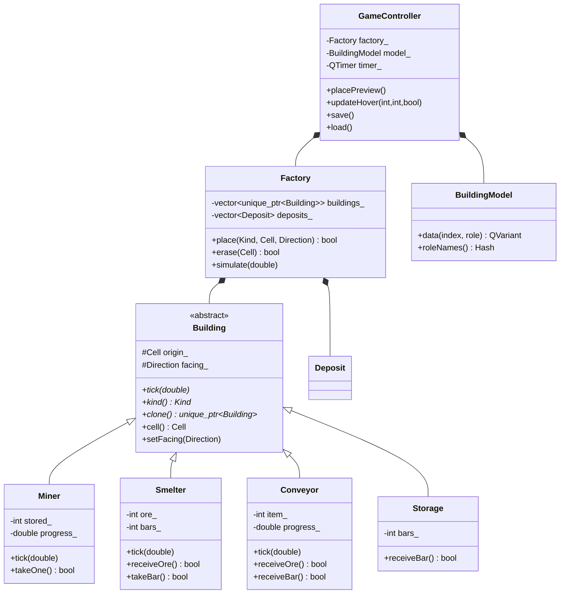

# ForgeFlow architecture (v0.1)

## Planned UML (Mermaid)

This is a diagram of the **current core and near-term Qt architecture**. It is not yet UML of the full final project: research, recipes, energy and additional machines must be added as they are designed.

## Core gameplay rules

- Map size: 24×24 integer grid. Four fixed mineral deposits.
- A miner can only be placed **on** a deposit. Other structures may not cover deposits.
- All buildings currently occupy **exactly one cell**. Rotation is four-valued, clockwise in 90° steps.
- Ore: Miner generates 1 unit per 2 seconds (maximum buffer 6).
- Processing: Smelter takes 3 seconds per ore to produce 1 iron bar (each buffer max 6).
- Transfer: Conveyor holds one item and moves it to the next cell after 0.65 seconds if accepted. An item blocked by a full destination waits.
- Storage holds iron bars (limit 999). A straight chain can be created with the supplied **Demo** button.
- Output points forward along the building's facing direction. There are **no** per-side inputs yet: smelters accept ore from any adjacent sender pointed at them. Future release will define machine ports.
- Simulation uses a 50 ms Qt timer and a fixed dt of 0.05 seconds. The world core itself does not depend on Qt.
- New game starts with no structures. Progression and unlocking are designed for a future version; v0.1 is a sandbox.

## Next architecture expansions

1. `BuildingDefinition`: width, height, connection ports, unlock tier, asset ID.
2. Typed `Item`, `Recipe`, `Inventory` and data-driven machine definitions.
3. Separate `BeltNetwork` for corners, splitters, merging and deterministic transport.
4. `TechnologyTree`, research conditions and progression/sandbox modes.
5. Incremental model updates to avoid per-tick `beginResetModel`.
6. Thread-safe simulation worker (only if measurements justify threading).
7. Unit tests for save validation, rotated footprints and belt/connector routing.

## Risks and grading

- **Don't add `new`/`delete` just to chase marks**: use a small strictly owned adapter with tests only if the teacher expects raw allocation. At the moment `unique_ptr`/`make_unique` are idiomatic and memory-safe; rubric items 41–42 are **not** claimed.
- A `friend`, template or thread should be introduced only for a real, documented use case.
- 3D engine use comes from **Qt Quick 3D**. Final grading and whether it meets item 57 must be checked with the lecturer; no claim of accepted grading is made yet.
